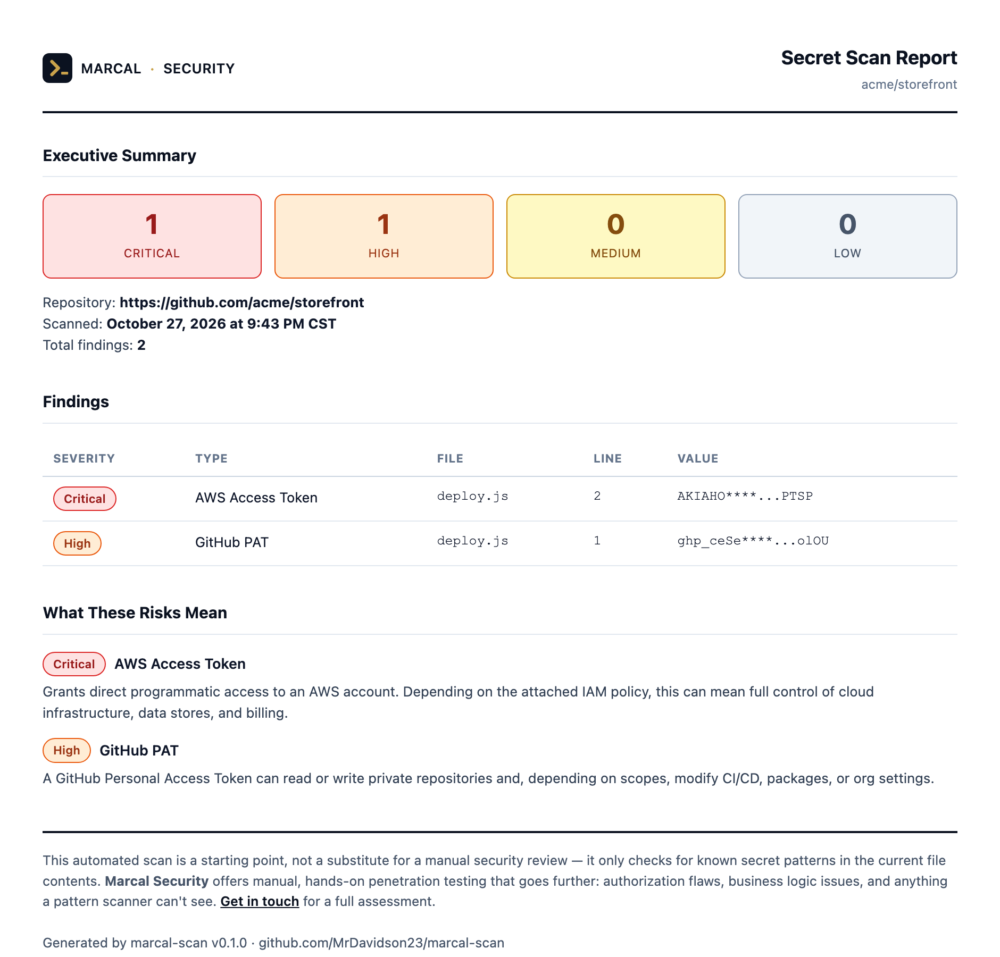

# marcal-scan

**Find exposed secrets and API keys in a GitHub repo or a local folder, and get a report a human can act on.**

marcal-scan runs [gitleaks](https://github.com/gitleaks/gitleaks) with a pinned ruleset, adds a severity and a plain-language risk explanation to each finding, masks every value, and outputs a terminal summary, JSON, a standalone HTML/PDF report, or SARIF for GitHub code scanning.

It's the open-source engine behind the hosted scanner at [marcalsecurity.com](https://marcalsecurity.com).



## Quick start

You need Node.js 20+ and gitleaks (`brew install gitleaks`, or see [their install docs](https://github.com/gitleaks/gitleaks#installing)).

```bash
npx marcal-scan https://github.com/owner/repo   # scan a public GitHub repo
npx marcal-scan .                               # scan the current folder
```

```
marcal-scan https://github.com/acme/storefront

  CRITICAL AWS Access Token
           deploy.js:2  AKIAHO****...PTSP
  HIGH     GitHub PAT
           deploy.js:1  ghp_ceSe****...olOU

2 findings: 1 critical, 1 high
```

### Options

| Option | What it does |
|---|---|
| `--format pretty\|json\|sarif` | Output on stdout (default `pretty`) |
| `--html <file>` | Write a standalone HTML report |
| `--pdf <file>` | Write a PDF report (needs `npm install puppeteer`) |
| `--sarif <file>` | Write SARIF 2.1.0 for GitHub code scanning |
| `--fail-on <severity>` | Exit 1 if any finding is at or above `critical`, `high`, `medium`, or `low` |

Exit codes: `0` ok, `1` findings at or above `--fail-on`, `2` usage or scan error. `GITHUB_TOKEN` raises GitHub's API rate limit for remote scans.

## GitHub Action

Scan every push and pull request, see results in the **Security** tab, and keep the HTML report as an artifact:

```yaml
name: Secret scan
on: [push, pull_request]

permissions:
  contents: read
  security-events: write

jobs:
  scan:
    runs-on: ubuntu-latest
    steps:
      - uses: actions/checkout@v4
      - uses: MrDavidson23/marcal-scan@v0.1.0
        with:
          fail-on: high          # critical | high | medium | low | none
      - uses: github/codeql-action/upload-sarif@v3
        if: always()
        with:
          sarif_file: marcal-scan.sarif
      - uses: actions/upload-artifact@v4
        if: always()
        with:
          name: marcal-scan-report
          path: marcal-scan-report.html
```

The action installs a pinned gitleaks release and verifies its SHA-256 before running it.

## As a library

```ts
import { scanRepo, renderReportHtml, toSarif } from "marcal-scan";

const outcome = await scanRepo("https://github.com/owner/repo");
if (outcome.ok) {
  console.log(outcome.result.summary);              // { total, critical, high, medium, low }
  const html = renderReportHtml(outcome.result);
  const sarif = toSarif(outcome.result);
}
```

## Security design

Every repository marcal-scan looks at is untrusted input. Someone can submit a repo built specifically to attack the scanner, so the threat model treats the repo's contents as hostile:

| Threat | Mitigation |
|---|---|
| A repo ships its own `.gitleaks.toml` to silence findings, or adds a rule with a catastrophic regex | gitleaks always runs with the vendored `config/gitleaks.toml` via `--config`, so the scanned repo can't change the ruleset. Covered by a test. |
| Decompression bomb: a small archive that expands to gigabytes | The download is streamed with a byte cap, and extraction counts bytes and entries and aborts at a limit. Covered by tests. |
| Symlinks or hard links that write outside the extraction folder | Link entries are never extracted. Covered by a test. |
| A file crafted to make gitleaks run forever | gitleaks is killed after a timeout (`SIGKILL`). |
| Malformed URLs such as `github.com/../..` that rewrite the GitHub API path | Dot-only segments are rejected, and URL-shaped input that isn't a valid repo URL is an error, never a local path. |
| Leaking the secrets it finds | Raw values never leave the gitleaks module. Every output (terminal, JSON, HTML, PDF, SARIF) only contains masked values, and tests assert the raw value is absent. |
| HTML injection through file names or fake secrets in the report | Every interpolated value is escaped. The report has no scripts and no external resources, and PDFs render with JavaScript disabled. |
| A compromised gitleaks download in CI | The release is pinned and checked against a SHA-256 before it's executed. |
| Shell injection through Action inputs | Inputs are passed as environment variables, never interpolated into the script. |

## Limitations

- **Current files only.** It scans the default branch's current contents (or the folder you point it at), not git history or other branches. A secret that was committed and later deleted is still exposed in history; use `gitleaks git` for that.
- **Pattern matching.** It finds secrets that match known formats. It can't tell whether a key is still valid, and generic high-entropy strings produce false positives.
- **Public repos only** for remote scans.
- **x64 Linux** is the only platform with a pinned binary in `scripts/install-gitleaks.mjs`. Elsewhere, install gitleaks yourself or set `GITLEAKS_BIN`.

## Development

```bash
npm install
npm test     # builds with tsc, then runs node:test (gitleaks tests skip if it isn't installed)
```

Test secrets are generated at runtime, so no secret-shaped string is ever committed. The repo scans itself in CI with its own action.

## License

MIT © Sebastián Quesada Calderón. gitleaks and its default ruleset are MIT-licensed by Zachary Rice; see [THIRD_PARTY_NOTICES.md](THIRD_PARTY_NOTICES.md).

Need more than a pattern scanner? [Marcal Security](https://marcalsecurity.com) does manual penetration testing.
